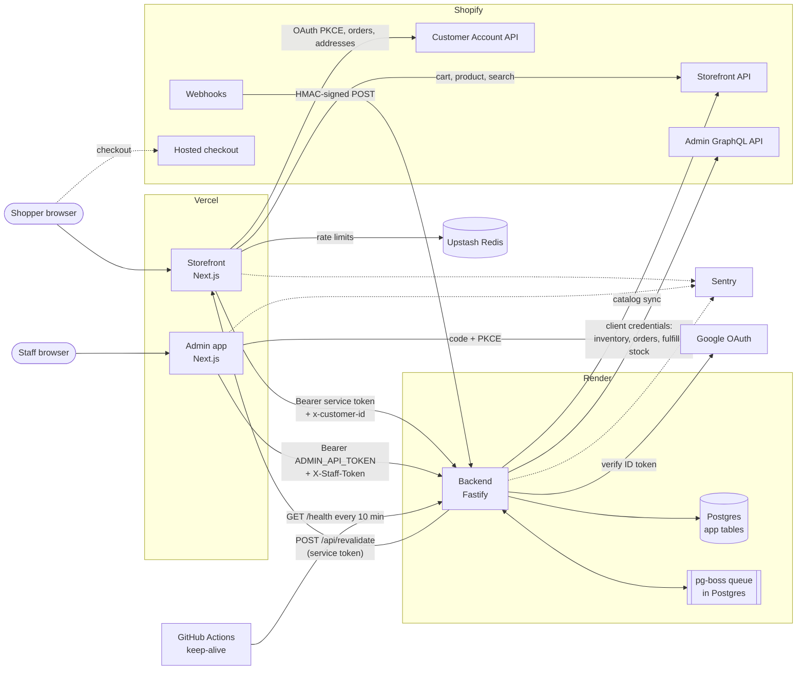

# Architecture

Three deployable apps and one database:

| App | Tech | Hosted | Talks to |
|---|---|---|---|
| Storefront (repo root) | Next.js 16 | Vercel | Shopify Storefront + Customer Account APIs, backend `/v1`, Upstash Redis, Sentry |
| Backend (`backend/`) | Fastify, Drizzle, pg-boss | Render ([`render.yaml`](../render.yaml)) | Postgres, Shopify Storefront + Admin APIs, storefront `/api/revalidate`, Sentry |
| Admin app (`admin/`) | Next.js 16 | Vercel (second project) | Google OAuth, backend `/admin/*`, Sentry |
| Postgres 16 | app tables + pg-boss schema | Render | — |

Browsers never call the backend. Only the two Next.js servers do, each with its own token.

## System diagram

## Request flows

### Catalog
1. A shopper opens a collection. The storefront calls `GET /v1/catalog` (and `/v1/catalog/overview`) with the service token (`lib/catalog-source.ts`, `lib/backend.ts`).
2. The backend answers from the `products` and `product_collections` tables; filters, sort, facets and paging run in SQL.
3. Results are cached in Next under the `catalog` tag. If the backend fails or returns nothing, the page shows **Try again** (`app/collections/error.tsx`). There is no Storefront API fallback for listings.
4. The table is filled by a nightly full sync (03:00 UTC) from the Storefront API and by catalog webhooks. After a change the backend calls the storefront's `POST /api/revalidate`, which clears the `catalog` tag.

Product pages, search, nav and the cart still call the Storefront API directly.

### Favourites
1. A signed-in shopper taps a heart. A server action calls `PUT /v1/favourites` with `x-customer-id` (the Customer Account ID token's `sub`).
2. Reads use `GET /v1/favourites`. If the read fails, the list shows as not loaded and no write is allowed over it (`lib/favourites-store.ts`).
3. Signed out: the click stores an intent in `sessionStorage` and redirects to login; the product is saved after sign-in.
4. `POST /v1/favourites/import` was a one-time migration from the old Shopify metafield (`customers.favourites_imported_at`). The storefront no longer calls it.

### Shopify webhooks
1. Shopify posts to `POST /webhooks/shopify`. The backend checks the HMAC over the raw body against `SHOPIFY_WEBHOOK_SECRET` and `SHOPIFY_ADMIN_CLIENT_SECRET`.
2. In one transaction it inserts into `webhook_events` (`on conflict (webhook_id) do nothing`) and queues a `shopify-webhook` job. A duplicate returns `200 {duplicate: true}`.
3. The worker runs the handlers for the topic (catalog, inventory, orders, fulfillments, locations). Up to 5 attempts; then the event is marked failed and reported.
4. `webhook-maintenance` (every 15 min) requeues events stuck for 30+ minutes; `webhook-purge` (05:00 UTC) deletes processed events after 30 days and failed ones after 90.

Order and inventory payloads are stored as `{ id }` only; the handler re-fetches from the Admin API.

### Inventory sync
1. Nightly full sync at 03:30 UTC, plus `inventory_levels/update` and `inventory_items/update` webhooks.
2. Pages through the Admin API (no bulk operations) into `locations`, `inventory_items`, `inventory_levels`, with changes to `available` logged in `inventory_level_history`.
3. Every write goes through `shouldApply`: data older than what's stored is ignored (see [RELIABILITY.md](RELIABILITY.md#ordering-shouldapply)).

### Orders sync
1. Nightly at 04:00 UTC, plus order and fulfillment webhooks.
2. Reads orders updated in the last **60 days** (the window `read_orders` allows without `read_all_orders`), 50 per page, into `orders` and `order_lines`, with fulfillment orders and fulfillments.
3. Never requests customer, email, phone, address or note fields. Older orders already stored are kept.

### Fulfillment
1. In the admin app an operator picks quantities, runs a **dry run**, and sees a confirm screen. The server seals the exact request and a new idempotency key into a ticket (`admin/lib/ticket.ts`).
2. Confirm sends `POST /admin/fulfillments` with that key. The backend writes a `pending` audit row first (fail closed), checks quantities against synced data, and inserts `fulfillment_actions` plus a `fulfillment-create` job in one transaction.
3. The job re-reads the fulfillment order live from Shopify, re-checks quantities, and calls `fulfillmentCreate` (`notifyCustomer` defaults to false).
4. If a retry finds the action still `submitting`, it adopts a fulfillment created in the last attempt's window (60 s slack) instead of sending again.
5. The progress page polls `GET /admin/fulfillments/:key`.

### Warehouse push
1. `/warehouse` shows `GET /admin/warehouse/diff`: mock warehouse quantity against Shopify `on_hand` per SKU and location.
2. An operator selects rows. The server re-reads the diff, builds a confirm screen and seals the idempotency key.
3. `POST /admin/warehouse/push` writes the audit row first, creates `warehouse_pushes`, and queues one `warehouse-push-item` job per inventory item (stately policy, one active plus one queued per item).
4. Each job takes an advisory lock, reads Shopify's live `on_hand`, skips no-change and large decreases, and in live mode calls `inventorySetQuantities` with `changeFromQuantity` (compare-and-set) and a deterministic `@idempotent` key. On `CHANGE_FROM_QUANTITY_STALE` it re-reads and retries up to 3 times.
5. Every decision is a `stock_push_log` row. With `WAREHOUSE_PUSH_MODE=dry_run` (the default) nothing is sent to Shopify.
6. `warehouse-reconcile` (every 30 min) refreshes the mirrored levels and counts the differences for `/health`.

### Staff sign-in
1. `/login` → `/auth/google`: the admin app creates state, nonce and a PKCE verifier in a sealed cookie and redirects to Google.
2. `/auth/callback` exchanges the code for a Google ID token and posts it to `POST /admin/auth/exchange`.
3. The backend verifies the token (Google JWKS, RS256, audience, nonce, `email_verified`, optional hosted domain), looks up the role in `ADMIN_ALLOWLIST`, upserts `staff`, and returns a 15-minute HS256 staff token.
4. The admin app keeps it in a sealed `httpOnly` cookie. `proxy.ts` refreshes it before expiry through `POST /admin/auth/refresh`. The session ends 8 hours after sign-in; refresh never extends that.
5. Every `/admin/*` call carries `ADMIN_API_TOKEN` and `X-Staff-Token`. The backend re-checks the allowlist role on every request.

## Scheduled jobs

All in pg-boss, UTC.

| Job | Schedule | Does |
|---|---|---|
| `catalog-full-sync` | `0 3 * * *` | Full catalog from the Storefront API |
| `inventory-full-sync` | `30 3 * * *` | Locations, items, levels from the Admin API |
| `orders-sync` | `0 4 * * *` | Orders updated in the last 60 days |
| `webhook-purge` | `0 5 * * *` | Delete old webhook events |
| `webhook-maintenance` | `*/15 * * * *` | Requeue or fail stuck webhook events |
| `warehouse-reconcile` | `*/30 * * * *` | Refresh mirrored levels for the warehouse diff (≤500 per run) |
| GitHub `keepalive.yml` | `*/10 * * * *` | Ping `/health`, alert on queue depth, job age, stuck webhooks, DB down |

A sync is also queued at startup when its table is empty.
